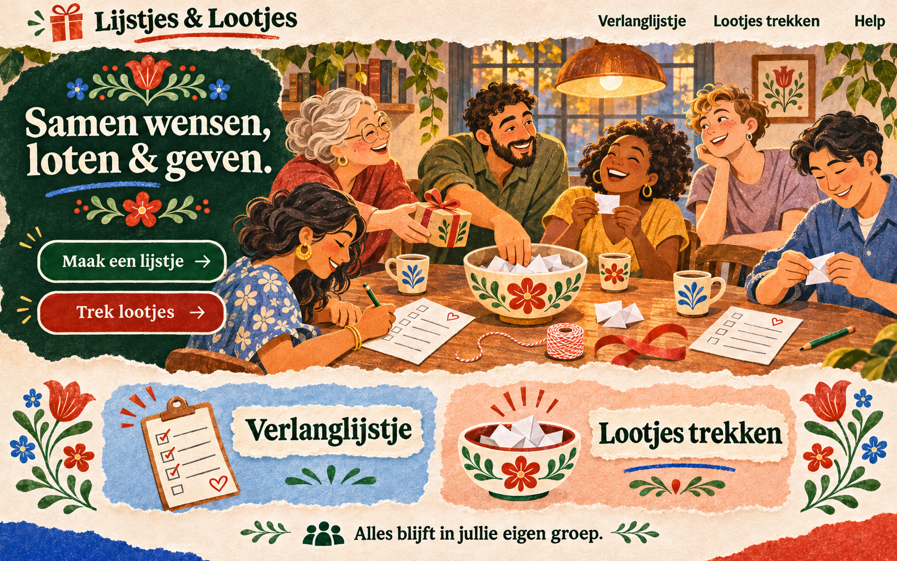
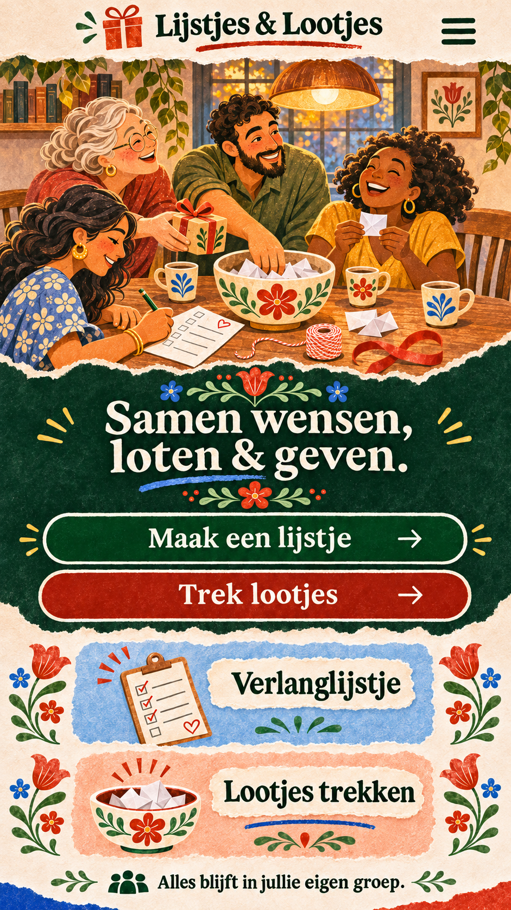

# Designhandboek — Lijstjes & Lootjes

**Versie:** 1.3  
**Status:** verfijnde voorkeursrichting, klaar voor implementatie  
**Bronrichting:** 65% *Samen aan Tafel* + 20% *Knip & Vier* + 15% warme sfeer en diepte

Dit document is de visuele en inhoudelijke bron van waarheid voor de website. Nieuwe pagina’s, illustraties en seizoensvarianten moeten hierop aansluiten. Afwijken mag alleen wanneer dat de bruikbaarheid of toegankelijkheid aantoonbaar verbetert en de afwijking daarna in dit document wordt vastgelegd.

## 1. Merkfundament

### Belofte

Lijstjes & Lootjes maakt samen cadeaus regelen persoonlijk, eenvoudig en gezellig. De techniek verdwijnt naar de achtergrond; de aandacht blijft bij de mensen en het geven.

De merkbelofte heeft drie vaste lagen:

1. **Functioneel:** maak en deel een verlanglijstje, of trek online lootjes met een groep.
2. **Emotioneel:** geef met aandacht.
3. **Bewijs:** geen account of app nodig; de relevante pagina’s worden via links gedeeld.

De functionele en emotionele laag horen op de homepage altijd bij elkaar. Alleen “verlanglijstjes maken en lootjes trekken” is duidelijk maar inwisselbaar. Alleen een warme merkzin is sympathiek maar onvoldoende concreet. De combinatie maakt binnen enkele seconden duidelijk wat het product doet en waarom dat ertoe doet.

De centrale homepagebelofte is:

> **Maak een lijstje. Trek lootjes. Geef met aandacht.**

“Samen” blijft een belangrijk merkwoord en komt terug in beeld, ondersteunende tekst en de groepscontext. Het hoeft niet geforceerd in iedere kop te staan.

### Vijf merkwoorden

1. **Samen** — nooit een solitaire productiviteitstool.
2. **Gezellig** — warm en menselijk, zonder decemberkitsch.
3. **Herkenbaar** — een eigen geïllustreerde wereld, geen generieke SaaS-vormgeving.
4. **Eenvoudig** — duidelijke keuzes en weinig beheer.
5. **Attent** — cadeaus gaan over aandacht, niet over consumeren.

### Dit zijn we wel

- Een gedeelde tafel, handgeschreven lijstjes en gevouwen lootjes.
- Warm Nederlands taalgebruik: direct, vriendelijk en nuchter.
- Een product dat zowel voor familie, vrienden als collega’s werkt.
- Feestelijk genoeg voor een bijzondere gelegenheid, neutraal genoeg voor het hele jaar.

### Dit zijn we niet

- Geen anonieme techtool met gradients, glazen kaarten en zwevende dashboards.
- Geen kinderwebsite of drukke cartoonspeeltuin.
- Geen luxe cadeaushop of koopplatform.
- Geen kerstsite die buiten december vreemd aanvoelt.
- Geen imitatie van Disney, bestaande prentenboeken of andere herkenbare studio’s.

## 2. Gekozen visuele richting

De basis is *Samen aan Tafel*: warme volkskunst, een gedeelde tafel, botanische decoratie en een rustige crème ondergrond. *Knip & Vier* levert een tweede laag: gescheurde papierranden, lichte risoprinttextuur, gestempelde accenten en een kleine dosis grafische energie. Een derde, kleinere laag voegt warm laat-middaglicht, meer diepte, natuurlijk oogcontact en intiemere interactie toe. De uitvoering blijft nadrukkelijk tweedimensionale gouache en papiercollage; geen glanzende 3D-animatiefilmstijl.

### Verhouding

- **65% warm en rustig:** geïllustreerde menselijke scènes, crème papier, groene basis en uitgebalanceerde compositie.
- **20% energiek en tactiel:** gescheurde randen, kobaltblauwe streepjes, imperfecte druktextuur en papieren labels.
- **15% sfeer en diepte:** een warme lichtbron, gelaagde voor- en achtergrond en natuurlijkere interactie tussen mensen.

De decoratieve 35% is verdeeld over materiaal en sfeer, niet over extra drukte. Niet elk vlak, label of component krijgt een gescheurde rand of warm lichteffect. De interface blijft eerst bruikbaar en daarna decoratief.

### Referentiemock-ups

De mock-ups tonen de sfeer en compositie, niet de technische uitvoering. Tekst, knoppen en navigatie worden in productie echte HTML-elementen. Belangrijke tekst wordt nooit in een illustratie ingebakken.

## 3. Ontwerpprincipes

### 3.1 Mensen vóór functies

De homepage begint met het gevoel van samen geven. De acties “Maak een lijstje” en “Trek lootjes” zijn vervolgens direct bereikbaar. Op functionele pagina’s keert de verhouding om: daar krijgt de taak voorrang en wordt illustratie een ondersteunend accent.

### 3.2 Handgemaakt, niet rommelig

Papiervezels, lichte kleurregistratie en imperfecte lijnen geven karakter. Formulieren, foutmeldingen en navigatie blijven recht, voorspelbaar en goed leesbaar.

### 3.3 Feestelijk zonder seizoen

Het neutrale merk gebruikt cadeaus, lint, lijstjes, potloden, kommen met lootjes en botanische motieven. Sneeuw, kerstbomen, mijters en andere seizoenssymbolen horen alleen bij een gekozen thema.

### 3.4 Eén duidelijke volgende stap

Elke pagina heeft één primaire actie. Een tweede actie mag zichtbaar zijn, maar krijgt minder gewicht. Vermijd rijen met drie of meer gelijkwaardige knoppen.

### 3.5 Geen decoratie zonder functie

Een gescheurde rand markeert een sectiewissel. Een label benoemt een keuze. Een stempel bevestigt een status. Losse versiering mag nooit invoer, tekst of focusranden hinderen.

## 4. Inclusieve representatie

In dit handboek spreken we over **mensen met lichte, medium en donkere huidtinten**. Illustraties moeten de samenleving vanzelfsprekend weerspiegelen, zonder één persoon als symbolische vertegenwoordiger van een hele groep te gebruiken.

### 4.1 Basisregels voor groepsillustraties

Voor iedere hoofdillustratie met vier of meer mensen gelden deze minimumregels:

- Toon een mix van lichte, medium en donkere huidtinten.
- Geen enkele waargenomen genderpresentatie vormt meer dan ongeveer 60% van de groep.
- Varieer vrouwelijke, mannelijke en androgyne presentatie zonder identiteit uit uiterlijk af te leiden.
- Gebruik minimaal drie duidelijk verschillende silhouetten of lichaamstypen.
- Varieer haartexturen, kapsels, gezichtskenmerken en kledingstijlen.
- Plaats niet steeds dezelfde persoon in het visuele midden of in de leidende rol.

Deze regels zijn een ondergrens, geen afvinklijst. Een geloofwaardige groep blijft belangrijker dan een mathematisch perfecte verdeling.

### 4.2 Verdeling over de volledige beeldbank

Beoordeel iedere set van zes hoofdillustraties als geheel:

| Onderdeel | Richtlijn voor de set |
|---|---|
| Huidtinten | Lichte, medium en donkere huidtinten komen ongeveer evenwichtig terug |
| Genderpresentatie | Vrouwelijk, mannelijk en androgyner gepresenteerde mensen hebben zichtbare rollen |
| Leeftijd | Jongvolwassenen, volwassenen van middelbare leeftijd en 50+ zijn vertegenwoordigd |
| Lichaam | Verschillende lengtes, posturen en lichaamsvormen |
| Beperking | Minimaal twee mensen met een zichtbare beperking, natuurlijk geïntegreerd |
| Groepstype | Familie, vrienden en collega’s; niet alleen traditionele gezinnen |

Een rolstoel, gehoorapparaat, prothese of wandelstok is geen verhaallijn op zichzelf. Het hulpmiddel hoort gewoon bij de persoon en wordt functioneel en anatomisch correct getekend.

### 4.3 Rollen rouleren

Houd per illustratieset bij wie:

- het initiatief neemt;
- een lijstje schrijft;
- het lootje trekt;
- een cadeau geeft;
- een cadeau ontvangt;
- uitleg geeft of helpt.

Verdeel deze rollen over huidtinten, genderpresentaties, leeftijden en lichaamstypen. Vermijd patronen zoals steeds een witte man als organisator, een vrouw als notulist of een oudere persoon als passieve toeschouwer.

### 4.4 Vermijd stereotypen

- Geen huidskleur gekoppeld aan vaste kledingkleuren, beroepen of rollen.
- Geen overdreven gelaatstrekken die een etniciteit karikaturiseren.
- Geen culturele kleding als decoratief kostuum zonder inhoudelijke context.
- Geen roze voor vrouwen en blauw voor mannen als systeem.
- Geen donkere huid uitsluitend in bijrollen of aan de rand van de compositie.
- Geen heterokoppel als automatische standaard voor iedere groep.

### 4.5 Review vóór publicatie

Bij ieder nieuw beeld beantwoorden ontwerper en reviewer samen:

1. Wie staat centraal en waarom?
2. Wie handelt en wie kijkt alleen toe?
3. Is de groep gevarieerd zonder samengesteld te voelen als een checklist?
4. Herhaalt dit beeld een patroon uit eerdere illustraties?
5. Zijn huidtinten, haren, handen en hulpmiddelen zorgvuldig weergegeven?

Bij twijfel wordt het beeld aangepast vóór implementatie.

## 5. Kleurensysteem

### 5.1 Basispalet

| Token | Hex | Gebruik |
|---|---:|---|
| `paper` | `#F8F0E3` | Hoofdachtergrond |
| `paper-white` | `#FFFDF8` | Velden en rustige kaarten |
| `ink` | `#1D2A22` | Primaire tekst en contouren |
| `muted` | `#596259` | Secundaire tekst |
| `forest` | `#174A36` | Primaire actie en merkanker |
| `forest-dark` | `#0F3627` | Hover en diepe vlakken |
| `brick` | `#A53A2E` | Lootjesactie en feestaccent |
| `brick-dark` | `#7C2B24` | Hover, fout en nadruk |
| `powder` | `#C8DCE8` | Verlanglijstvlakken |
| `peach` | `#F2C8B7` | Lootjesvlakken en warmte |
| `cobalt` | `#1C4CB4` | Kleine grafische accenten en focus |
| `line` | `#CDBEA9` | Randen en scheidingen |

De belangrijkste combinaties voldoen aan WCAG AA voor normale tekst:

- `ink` op `paper`: **13,2:1**
- `muted` op `paper`: **5,6:1**
- wit op `forest`: **10,15:1**
- wit op `brick`: **6,47:1**
- wit op `cobalt`: **7,66:1**

### 5.2 Kleurverhouding

- **70%** crème, papierwit en houtachtige neutralen.
- **20%** bosgroen, poederblauw en perzik.
- **10%** baksteenrood en kobaltblauwe accenten.

Kobaltblauw is een accent, geen grote paginavulling. Rood wordt niet voor elke fout én elke primaire actie gebruikt; context en tekst maken de betekenis duidelijk.

### 5.3 Functionele kleur

- Primaire actie: `forest`.
- Lootjesactie: `brick`, alleen wanneer de twee productroutes naast elkaar staan.
- Focus: `cobalt`, minimaal 3 px zichtbaar met offset.
- Succes: groen met tekst of pictogram.
- Waarschuwing: oker met tekst of pictogram.
- Fout: donker baksteenrood met concrete herstelactie.

Status wordt nooit uitsluitend door kleur gecommuniceerd.

## 6. Typografie

### 6.1 Letterfamilies

- **Merk en display:** `Fraunces`, gewichten 600–700. Warm, stevig en licht eigenzinnig.
- **Interface en lopende tekst:** `Atkinson Hyperlegible`, gewichten 400, 600 en 700.
- **Fallback display:** Iowan Old Style, Palatino, Georgia, serif.
- **Fallback interface:** Avenir Next, Segoe UI, Arial, sans-serif.

Webfonts worden bij implementatie als WOFF2 zelf gehost en gesubset. Tot dat moment blijven de bestaande systeemfallbacks actief.

### 6.2 Schaal

| Stijl | Desktop | Mobiel | Richtlijn |
|---|---:|---:|---|
| Hero | 72–104 px | 46–60 px | Maximaal 3 regels |
| H1 functioneel | 52–72 px | 40–48 px | Kort en taakgericht |
| H2 | 36–48 px | 30–36 px | Duidelijke secties |
| H3 | 22–28 px | 21–24 px | Kaarten en stappen |
| Body groot | 19–22 px | 18–20 px | Introducties |
| Body | 16–18 px | 16–18 px | Nooit onder 16 px |
| Label | 14–16 px | 14–16 px | Minimaal gewicht 600 |

Koppen gebruiken een regelhoogte van 0,95–1,08; lopende tekst 1,5–1,65. Gebruik hoofdletters alleen voor korte wenkbrauwlabels. Lange teksten worden nooit gecentreerd.

## 7. Logo en woordmerk

Het logo bestaat uit een eenvoudig cadeau-icoon, een kleine handgemaakte accentstreep en het woordmerk **Lijstjes & Lootjes**.

### Gebruik

- Vrije ruimte rondom: minimaal de halve breedte van het cadeau-icoon.
- Minimale breedte desktop: 150 px.
- Minimale breedte mobiel: 128 px.
- Op lichte achtergrond: bosgroen woordmerk, baksteenrood cadeau.
- Op donkere achtergrond: papierwit woordmerk, warm rood of geel cadeau.

### Niet doen

- Geen slagschaduw, glow of verloop in het logo.
- Niet schuin trekken of uitrekken.
- Geen seizoenstekens in het basislogo verwerken.
- Geen andere cadeau-emoji naast het logo plaatsen.

Seizoensvarianten mogen alleen de accentstreep en één secundaire kleur aanpassen. Vorm en woordmerk blijven gelijk voor herkenning.

## 8. Illustratiesysteem

### 8.1 Beeldtaal

- Digitale illustratie die aan gouache, papiercollage en lichte risoprint doet denken.
- Zichtbare papiervezel, maar nooit zoveel ruis dat tekst minder leesbaar wordt.
- Vereenvoudigde vormen met geloofwaardige handen, houdingen en hulpmiddelen.
- Warme gezichten met verschillende neuzen, kaaklijnen, ogen, haartexturen en huidondertonen.
- Botanische volkskunst als kader of accent, niet als doorlopend behang.
- Eén warme lichtbron mag mensen en de gezamenlijke handeling verbinden; gezichten blijven handgeschilderd en mat, nooit glanzend of driedimensionaal.

### 8.2 Terugkerende voorwerpen

- handgeschreven lijstje;
- potlood of pen;
- gevouwen lootje;
- kom voor de trekking;
- cadeau met lint;
- papieren label;
- gedeelde tafel;
- eenvoudige bloem- en bladmotieven.

Deze objecten vormen de herkenbare merktaal. Gebruik liever deze eigen symbolen dan generieke emoji of een standaard icon library.

### 8.3 Compositie

- Hoofdpersonen kijken naar elkaar of naar de gezamenlijke handeling, niet allemaal naar de camera.
- Laat handen iets doen: schrijven, vouwen, trekken, geven of vasthouden.
- Houd rond belangrijke HTML-tekst voldoende rustige ruimte.
- Snijd op mobiel terug naar drie of vier personen in plaats van de volledige desktopgroep te verkleinen.
- Een scène bevat maximaal twee ingepakte cadeaus; het gaat om aandacht, niet om overvloed.
- Gebruik warm laat-middag- of vroeg-avondlicht in de neutrale variant, maar geen donkere winteravond, lichtslingers of andere seizoenssignalen.

### 8.4 Technische levering

Per hoofdillustratie worden geleverd:

1. desktopbeeld zonder tekst, 16:9 of breder;
2. mobiele uitsnede zonder tekst, ongeveer 4:5;
3. transparante losse motieven als SVG of PNG;
4. WebP en AVIF voor rasterbeelden;
5. betekenisvolle alt-tekst, of lege alt-tekst wanneer het beeld puur decoratief is.

Richtwaarde: maximaal 250 kB voor een zichtbare hero-variant na optimalisatie. Illustraties onder de vouw worden lazy-loaded.

## 9. Vormtaal en materiaal

### Gescheurd papier

Gebruik voor:

- overgang tussen hero en productkeuze;
- koplabel op een grote illustratieve kaart;
- een incidentele campagnebanner.

Niet gebruiken voor invoervelden, foutmeldingen, tabellen, beheerlinks of ieder individueel lijstitem.

### Randen en hoeken

- Functionele kaarten: 8–12 px radius.
- Grote illustratieve vlakken: 12–20 px of een papieren maskerrand.
- Knoppen: 8–12 px, niet volledig pilvormig.
- Formuliervelden: 6–8 px.
- Lijnen: 1–2 px in `ink` of `line`.

### Schaduw en diepte

- Geen diffuse SaaS-schaduwen onder iedere kaart.
- Toegestaan: een harde papieren verschuiving van 4–8 px of een subtiele contactschaduw.
- Maximaal één dieptetechniek per component.

### Textuur

Textuur staat op maximaal 3–5% dekking achter interface-elementen. Formuliervelden en kleine tekst krijgen een vrijwel egale achtergrond.

## 10. Layout en responsive gedrag

### Raster

- Maximale inhoudsbreedte: 1180 px.
- Desktop: 12 kolommen.
- Tablet: 8 kolommen.
- Mobiel: 4 kolommen.
- Buitenmarge: 20 px mobiel, 32 px tablet, 40 px desktop.
- Basiseenheid voor ruimte: 8 px.

### Ruimteschaal

`4, 8, 12, 16, 24, 32, 48, 64, 96, 128 px`

Gebruik binnen componenten vooral 8–24 px. Gebruik 64–128 px tussen grote verhaalsecties.

### Breakpoints

- Tot 559 px: mobiel.
- 560–859 px: compact/tablet.
- Vanaf 860 px: desktop.
- Vanaf 1180 px: brede compositie, inhoud groeit niet verder mee.

### Mobiel

- Navigatie wordt een duidelijke menuknop met tekstlabel voor screenreaders.
- Primaire acties staan onder elkaar en vullen de beschikbare breedte.
- Illustratie, kop en actie vormen één logische leesvolgorde.
- Tikdoelen zijn minimaal 44 × 44 px; primaire knoppen minimaal 48 px hoog.
- Geen sticky elementen die meer dan 20% van het scherm bedekken.

## 11. Kerncomponenten

### Header

- Logo links, maximaal drie hoofdroutes.
- Desktop toont: Verlanglijstje, Lootjes trekken, Help.
- Namenrad blijft secundair in de footer.
- Header is rustig; geen seizoensillustratie achter navigatietekst.

### Hero

- Eén korte belofte: **Maak een lijstje. Trek lootjes. Geef met aandacht.**
- Ondersteunende tekst: **Maak een verlanglijstje of trek online lootjes met familie, vrienden of collega’s. Zonder account — persoonlijk geregeld via een link.**
- Twee acties: groen voor lijstje, baksteenrood voor lootjes.
- De acties heten **Maak een verlanglijstje** en **Trek lootjes**. Gebruik hier geen generieke linktekst zoals “Open”.
- Illustratie ondersteunt de keuze, maar knoppen blijven echte UI.
- Geen carrousel en geen automatisch bewegende onderdelen.
- Gebruik “loten” niet als verkorting van “lootjes trekken”; het is abstracter en kan een andere betekenis oproepen.
- Gebruik “zonder dubbele cadeaus” niet als algemene hero-belofte. Die productclaim hoort alleen bij het losse verlanglijstje met reserveringen.

De hero-copy wordt als echte HTML uitgevoerd en nooit onderdeel van de illustratie. De H1 bevat één volledige gelokaliseerde boodschap; regelafbrekingen mogen visueel ontstaan, maar worden niet als losse zinsfragmenten aan elkaar geplakt in de vertaalcatalogus.

### Productkeuzes

- Verlanglijstje gebruikt poederblauw als ondersteunend vlak.
- Lootjes trekken gebruikt perzik als ondersteunend vlak.
- Beide routes krijgen evenveel visueel gewicht.
- Iconen zijn eigen illustraties: cadeau/lijst en kom/lootjes.

De vaste Nederlandse productcopy voor de homepage is:

| Route | Titel | Uitleg | Actie |
|---|---|---|---|
| Verlanglijstje | **Verlanglijstje maken** | Zet je wensen op één plek en deel je lijst. Gasten kunnen cadeaus reserveren, zodat dubbele cadeaus worden voorkomen. | **Maak een verlanglijstje** |
| Lootjes | **Lootjes trekken** | Trek eerlijk lootjes en deel met iedereen een eigen link. De organisator ziet niet wie wie heeft getrokken. | **Trek lootjes** |

Onder of direct na de productkeuzes mag als vertrouwensregel staan:

> **Jullie bepalen zelf met wie je de links deelt.**

Deze formulering is controleerbaar en legt de verantwoordelijkheid helder uit. Gebruik niet zonder nadere uitleg “Alles blijft in jullie eigen groep”; de gegevens worden door de dienst opgeslagen en toegang is afhankelijk van het zorgvuldig delen van capabilitylinks.

### Formulieren

- Labels staan altijd zichtbaar boven het veld.
- Placeholder is voorbeeld, nooit het enige label.
- Hulptekst staat direct bij het relevante veld.
- Fouttekst zegt wat fout is én hoe het hersteld kan worden.
- Lange processen worden in kleine, benoemde stappen verdeeld.

### Wensen en cadeaus

- Een wens is een rustig papieren kaartje, niet een webwinkelkaart.
- Titel staat voorop; prijs, link en notitie zijn secundair.
- Reserveren is duidelijk maar niet commercieel vormgegeven.
- Binnen een lootjestrekking bestaan geen reserveringsstatussen.

### Onthulling van het lootje

- De naam van de ontvanger is het emotionele moment en krijgt displaytypografie.
- Animatie is kort en optioneel; geen rad, vuurwerk of langdurige confetti.
- Daarna volgen onmiddellijk het lijstje van de ontvanger en de eigen lijsteditor.

### Meldingen

- Succes, waarschuwing en fout hebben pictogram, kop en tekst.
- Meldingen verschuiven de inhoud niet onverwacht.
- Technische foutcodes worden niet aan gebruikers getoond.

## 12. Beweging

- Hover: maximaal 1–2 px lift of een kleine stempelrotatie.
- Overgangen: 120–220 ms.
- Geen zwevende decoraties, oneindige loops of parallax.
- Een getrokken lootje mag één korte ontvouwing van maximaal 500 ms hebben.
- Bij `prefers-reduced-motion: reduce` verdwijnen niet-essentiële animaties volledig.

## 13. Toegankelijkheid

Doel: WCAG 2.2 AA op alle publieke en persoonlijke routes.

- Tekstcontrast minimaal 4,5:1; grote tekst minimaal 3:1.
- Focusindicator minimaal 3 px en nooit verborgen door textuur.
- Alles is met toetsenbord te bedienen.
- Zoom tot 200% veroorzaakt geen verlies van inhoud of bediening.
- Formulierfouten zijn programmatisch gekoppeld aan het veld.
- Koppen volgen een logische hiërarchie.
- Illustraties met informatie krijgen alt-tekst; sfeerbeelden `alt=""`.
- Kleur, positie of vorm is nooit de enige betekenisdrager.
- Touch targets zijn minimaal 44 × 44 px.
- Tekst in echte HTML, niet in rasterbeelden.

## 14. Taal en tone of voice

### Stem

Warm, eenvoudig en volwassen. Schrijf op B1-niveau waar mogelijk. Gebruik **je** voor één persoon en **jullie** voor de groep.

### Wel

- “Maak je lijstje.”
- “Deel deze link alleen met je groep.”
- “Je hebt Noor getrokken.”
- “Voeg een wens toe.”

### Niet

- “Start jouw magische gifting journey.”
- “Gefeliciteerd!!! 🎉🎁✨”
- “Er is een onbekende fout opgetreden.”
- “Klik hier.”

Humor mag in kleine accenten, maar nooit in privacy-, fout- of veiligheidsmeldingen.

### 14.1 Copyarchitectuur

Gebruik op marketingpagina’s deze volgorde:

1. **Zeg wat iemand kan doen.** Gebruik herkenbare producttaal zoals “verlanglijstje maken” en “lootjes trekken”.
2. **Zeg waarom dat prettig is.** Benoem aandacht, eenvoud of persoonlijk geven.
3. **Onderbouw met één concreet bewijs.** Bijvoorbeeld geen account, een persoonlijke link of reserveringen tegen dubbele cadeaus.
4. **Eindig met een beschrijvende actie.** De knop noemt de taak en nooit alleen “Open”, “Verder” of “Klik hier”.

De homepage combineert twee zoekintenties en een merkbelofte. De functionele routes richten zich ieder op één taak:

| Pagina | Primaire intentie | Merkrichting |
|---|---|---|
| Homepage | verlanglijstje maken + online lootjes trekken | geven met aandacht |
| Verlanglijstje | verlanglijstje maken en delen | wensen overzichtelijk en persoonlijk delen |
| Lootjes | online lootjes trekken | eerlijk, geheim en persoonlijk geregeld |

### 14.2 Vaste terminologie

- Gebruik **verlanglijstje** als primaire productterm. “Lijstje” mag in warme, korte merkcopy wanneer de context al duidelijk is.
- Gebruik altijd **lootjes trekken** voor de trekking. Vermijd “loten”.
- Gebruik **trekking** voor het aangemaakte groepsproces en **lootje** voor de persoonlijke toewijzing.
- Gebruik **persoonlijke link**, **beheerlink** en **gastenlink** wanneer het onderscheid voor veiligheid of begrip relevant is.
- Schrijf **en** in lopende zinnen. Het ampersand hoort bij het woordmerk **Lijstjes & Lootjes**, niet als standaardvervanger van “en”.
- Spreek één persoon aan met **je** en een groep met **jullie**. Gebruik familie, vrienden en collega’s als gelijkwaardige voorbeelden; behandel geen enkel groepstype als standaard.

### 14.3 Claimgrenzen

Claims moeten aantoonbaar kloppen voor de route waarop ze staan:

- **Geen account nodig** mag voor beide hoofdroutes in de MVP.
- **Geen app nodig** mag zolang alle kernfuncties volledig in de browser werken.
- **Voorkomt dubbele cadeaus** hoort alleen bij een los verlanglijstje waarop gasten kunnen reserveren.
- **De organisator ziet niet wie wie heeft getrokken** hoort bij de lootjesroute.
- **Gratis** wordt pas prominente merkcopy na een duurzame product- en verdienmodelbeslissing.
- Vermijd absolute privacyclaims als “volledig privé” of “blijft alleen in jullie groep”. Leg concreet uit wat links doen en wie toegang krijgt.

### 14.4 Homepage-metadata

De Nederlandse homepage gebruikt bij lancering:

- **Paginatitel:** `Verlanglijstje maken en online lootjes trekken | Lijstjes & Lootjes`
- **Metabeschrijving:** `Maak en deel een verlanglijstje of trek online lootjes met familie, vrienden of collega’s. Zonder account of app, met persoonlijke links voor iedereen.`
- **Open Graph-titel:** `Maak een lijstje. Trek lootjes. Geef met aandacht.`

Metadata blijft beschrijvend en beknopt. Koppen worden voor mensen geschreven; herhaal zoektermen niet onnatuurlijk en maak niet meerdere visueel even zware hoofdtitels.

## 15. Seizoensthema’s

Het basismerk blijft in alle varianten minimaal 80% hetzelfde. Alleen accenten, patronen, enkele motieven en illustratiedetails veranderen.

### Neutraal

- Basis: crème, bosgroen, baksteenrood, poederblauw en kobalt.
- Motieven: bloemen, lint, lijstjes, gevouwen papier en cadeaulabels.
- Kleding: gewone casual kleding, geen duidelijke winter- of feestkleding.

### Sinterklaas — later uitwerken

- Toevoegingen: nachtblauw, warm goud, boekpapier, briefvormen en subtiele dakenlijn.
- De focus blijft op samen lootjes trekken en cadeaus geven.
- Geen blackface, Zwarte Piet of racistische karikaturen.
- Eventuele helpers worden eigentijds, inclusief en zonder stereotiepe kenmerken weergegeven.
- Geen volledige herbouw van de layout; het is een themalaag.

### Kerst — later uitwerken

- Toevoegingen: dieper dennengroen, besrood, amberlicht en eenvoudige dennentakmotieven.
- Warm licht mag, maar tekstvlakken behouden hun contrast.
- Vermijd een overdaad aan sneeuw, glitters, ornamenten en standaard stockkerstbeelden.
- De groep blijft cultureel en qua gezinssamenstelling gevarieerd.

### Technische themaregel

Thema’s worden uiteindelijk gestuurd door semantische tokens, bijvoorbeeld `data-theme="neutral"`, `data-theme="sinterklaas"` en `data-theme="christmas"`. Componentmarkup en interactie veranderen niet per seizoen.

## 16. Benodigde assetbibliotheek

### Lancering

- 1 neutrale desktophero.
- 1 neutrale mobiele hero-uitsnede.
- 2 productillustraties: verlanglijstje en lootjes trekken.
- 6–8 botanische hoek- en randmotieven als SVG.
- 4 papieren randmaskers.
- 1 subtiele papiertextuur.
- 8 eigen pictogrammen: cadeau, lijst, potlood, link, kopiëren, lootje, kom en groep.
- 3 statuspictogrammen: succes, waarschuwing en fout.

### Later per seizoen

- 1 hero-variant desktop en mobiel.
- 4 seizoensmotieven.
- Aangepaste kleurentokens.
- Geen nieuwe iconenset of componentvormen.

### Bestandsnamen

Gebruik lowercase kebab-case met thema en formaat:

`hero-neutral-desktop.avif`  
`hero-neutral-mobile.webp`  
`motif-neutral-flower-corner.svg`  
`paper-edge-neutral-01.svg`

## 17. Ontwerp- en implementatieplan

### Fase 1 — Fundament

- Definitieve logo- en woordmerkbestanden maken.
- Fraunces en Atkinson Hyperlegible self-hosten.
- Kleuren, ruimte, radius en typografietokens invoeren.
- Papiertextuur en randmaskers technisch testen.

### Fase 2 — Homepage

- Nieuwe hero als HTML/CSS met losse illustratie bouwen.
- Productkeuzes en vertrouwensboodschap uitwerken.
- Desktop, tablet en mobiel visueel vergelijken met de mock-ups.
- Performance en toegankelijkheid controleren.

### Fase 3 — Productflows

- Formulieren, wensitems en trekkingbeheer naar hetzelfde systeem brengen.
- Lootjesonthulling als eigen herkenbaar moment uitwerken.
- Lege, fout-, laad- en successtatussen ontwerpen.

### Fase 4 — Inclusieve beeldbank

- Character sheet met leeftijden, huidtinten, haartexturen, lichaamstypen en hulpmiddelen.
- Rollenmatrix invullen vóór illustraties worden gemaakt.
- Illustraties door minimaal twee mensen laten reviewen op representatie en anatomie.

### Fase 5 — Seizoensthema’s

- Eerst Sinterklaas en kerst als kleur- en motiefproef.
- Daarna alleen goedgekeurde accenten produceren.
- Neutraliteit buiten het seizoen opnieuw controleren.

## 18. Definition of done

Een pagina of component is pas klaar wanneer:

- hij herkenbaar binnen de 5+6-richting valt;
- de primaire taak binnen enkele seconden duidelijk is;
- desktop en mobiel inhoudelijk dezelfde kwaliteit hebben;
- contrast, focus en toetsenbordbediening voldoen;
- er geen belangrijke tekst in afbeeldingen staat;
- representatie volgens hoofdstuk 4 is beoordeeld;
- de pagina werkt met reduced motion en tot 200% zoom;
- illustraties geoptimaliseerd en correct beschreven zijn;
- de neutrale variant geen onbedoelde kerst- of winterassociatie krijgt.

## 19. Snelle reviewscore

Geef ieder onderdeel 0, 1 of 2 punten:

| Vraag | 0 | 1 | 2 |
|---|---|---|---|
| Voelt het samen en menselijk? | Nee | Deels | Duidelijk |
| Is de hoofdactie direct zichtbaar? | Nee | Na zoeken | Meteen |
| Is de 65/20/15-balans rustig? | Te vlak/druk | Bijna | In balans |
| Is representatie zorgvuldig? | Stereotiep | Beperkt | Natuurlijk gevarieerd |
| Is het toegankelijk? | Blokkades | Kleine punten | AA-proof |
| Is het neutraal buiten december? | Nee | Twijfel | Ja |
| Is het herkenbaar zonder logo? | Nee | Enigszins | Ja |

Een ontwerp gaat pas door bij minimaal **12 van 14 punten**, zonder een 0 op toegankelijkheid of representatie.

## 20. Vertaling en internationale interfaces

De visuele identiteit blijft gelijk tussen talen, maar de layout moet langere vertalingen kunnen dragen. De technische afspraken staan in `LOCALIZATION.md`.

- Nederlands is de huidige standaardinterface, niet de interne taal van de applicatie.
- Backend, API, datamodel, statuswaarden en foutcodes zijn Engels en taalneutraal.
- Zichtbare tekst komt uiteindelijk uit getypeerde vertaalcatalogi met Engelse semantische sleutels.
- Ontwerpen reserveren minimaal 35% ruimte voor tekstuitbreiding.
- Knoppen en navigatie krijgen geen vaste tekstbreedte.
- Belangrijke tekst blijft HTML en wordt nooit in een illustratie ingebakken.
- Datums, getallen en valuta volgen de gekozen interface-locale.
- Namen, wensen, notities en andere gebruikersinhoud worden niet automatisch vertaald.
- Een taalwissel mag een persoonlijke token, sessie of onafgemaakte invoer niet verliezen.

De neutrale multiculturele beeldtaal vormt de gedeelde basis voor alle locales. Een vertaling mag niet automatisch een cultureel of religieus thema activeren.
